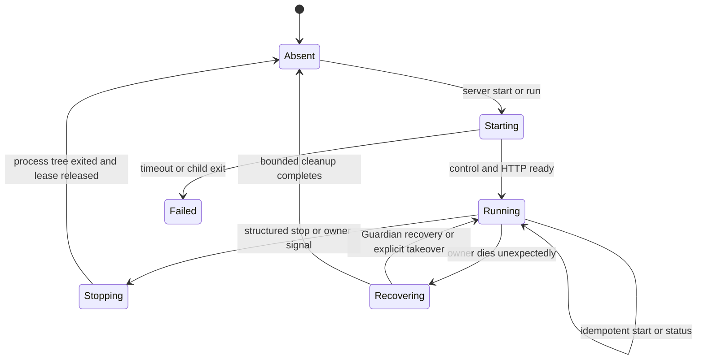

# Remote Runtime and Access

This guide owns OpenAlice's remote Runtime architecture: server lifecycle,
local and remote client responsibilities, SSH transport, managed remote
bootstrap, control/status contracts, multi-client authority, and the staged
path toward an independent Studio frontend.

Start with [[docs/remote-quickstart.md]] for user-facing setup. This guide
complements [[docs/alice-project.md]], [[docs/cli-supervisor.md]], and
[[docs/managed-workspace-runtime.md]].

## Status

The Bun-native Runtime, registered SSH Machines, managed remote bootstrap,
and AliceProject transfer are implemented; source checkout remains an
explicit development override ([[docs/alice-project.md]]). The installer
advances one checksum-bound native release; Agent Runtime executables are
user-owned and only discovered from `PATH`. Normal `pnpm dev` puts the relay
in front of Vite. Native `server run/start` derives content identity from
the installed `release.json`; readiness confirms pending activation only when
identity matches the installed pointer; ownership contention exits 75 without
rolling back the installed release.

## Product Decision

| Surface | Presentation runs | Runtime runs | Purpose |
|---|---|---|---|
| Electron | local packaged app | local Electron-owned Runtime | complete desktop distribution |
| Local browser | local browser | local Guardian-owned Runtime | low-friction CLI distribution and development |
| SSH browser | local browser | remote Guardian-owned Runtime | same product over an authenticated transport |
| Independent Studio | local or hosted web client | local, remote, or managed Runtime | later presentation-neutral client |

Electron must remain complete; the CLI/server path does not replace its
`app://` protocol, preload/IPC, packaged PTY, signing, updater, or managed
runtime. The first remote product reuses the normal browser application over
an SSH loopback tunnel; a hosted Studio protocol is deferred until the
local/server boundary is stable.

## Vocabulary

- **Runtime**: the Guardian-owned process tree and user state under one
  `OPENALICE_HOME` (Alice, optional UTA/Connector, workspaces, PTYs, Agent
  CLIs, schedules, file-backed state). **Server**: a Runtime started detached
  without owning a browser/terminal.
- **Transport**: how a client reaches a Runtime; the first remote transport is
  OpenSSH and is not Runtime state. **Control endpoint**: user-local,
  non-network Guardian endpoint for status and graceful shutdown, distinct
  from Alice HTTP/MCP/UTA/Connector/PTY endpoints.

## Architectural Invariants

1. The machine that owns the files owns the Workspace, Agent processes, tool
   execution, provider requests, and trading boundary.
2. Guardian remains the final single-writer and process-tree authority for an
   `OPENALICE_HOME`; a CLI command may not invent a parallel lock.
3. UTA remains optional; server, remote status, browser Chat, and non-trading
   work must function in lite/read-only mode.
4. Alice binds to `127.0.0.1`; internal ports are never made public to enable
   remote access.
5. SSH authenticates and encrypts transport; it does not silently grant
   install, update, start, takeover, or stop consent.
6. Disconnecting a browser, renderer, CLI, or tunnel does not stop a detached
   Server.
7. `down` / `server stop` ask the owning Guardian to terminate its own tree;
   they never signal a guessed PID or delete a live lock. `--takeover` is the
   only CLI authority to replace another recorded owner.
8. Remote bootstrap reuses the invoking CLI's recorded installer source and
   logical release identity; each host verifies its own archive checksum and
   content identity. Bootstrap carries no second SSH-only installer, uploads
   no Runtime bytes, installs no Node/build tools, checkout, or Agent Runtime.
   Only explicit `--app-dir` opts into source preparation.
9. Shared Runtime facts use presentation-neutral names and versioned schemas;
   client UI state never becomes server truth.

The relay owns a single active Machine operation; `/relay/v1/machines/operation`
reports actual check/install/restart/verification stages to the GUI and
Electron (via IPC). A running operation blocks location switching. Relay
status reports `targetConnection` separately from the selected target; failed
proxied requests or SSH exit trigger one relay-owned reconnect attempt that
increments the target generation so clients retire stale sockets. Fleet
discovery is not part of the heartbeat because it may require SSH.

## AliceProject Transfer

First direction: local AliceProject to a registered SSH Machine. `--plan`
inventsories without changing either host; apply requires confirmation or
`--yes`, a stopped source (or `--stop-source`), and an unoccupied project
key/Home. Transfer never means takeover, move, merge, deletion, Runtime
start, or default selection. The sender uses a versioned bounded stream over
SSH stdin; the receiver validates paths/types/symlinks/sizes/checksums/space,
writes an owner-private staging Home, then atomically publishes and registers
it without changing the remote default. A published receipt makes retry
idempotent.

Portable configuration, Workspace repositories/ids, and lifecycle records
transfer (absolute Workspace paths rebased). Git Workspaces keep portable
object/ref/index state, tracked files, and nonignored untracked user files;
machine-local config and ignored build outputs stay behind. Linked worktrees,
alternate/promisor object stores, nested Git repos, and submodules block
apply. Guardian state, Runtime payloads, ports, Web auth/sessions, headless
conversation state, resume identities, Agent login/config, and untracked
Session dossiers do not transfer. Only Alice-owned AI/market/broker/Connector
credentials travel in the SSH stream, re-sealed with a newly created
destination key; the source sealing key is never copied. Exact-Session
scheduled Issue owners require an explicit `keep-blocked` or
`new-then-resume` policy.

## Layered Topology

```text
presentation plane   browser | Electron | future Studio
transport plane      loopback HTTP/WS | Electron IPC | SSH loopback
runtime/control plane  Guardian lease + local control endpoint + Alice APIs
execution plane      Workspace files + PTYs + Agent CLIs + tools + optional UTA
```

In an SSH-browser session the browser is local but shell/TUI and model loop
are remote: keystrokes cross the network to the remote PTY; screen changes
return over the Workspace WebSocket.

## Command Contract

The default `openalice` command starts the local TUI and its Web relay;
`openalice relay` runs the same Web controller without TUI presentation. The
relay owns one active Machine/AliceProject target for all attached browser
tabs; browsers never open a Runtime or forwarded port directly.

```bash
openalice
openalice relay
openalice machine add <user@host> --label <name>
openalice --machine <id-or-label> <command> [options]
openalice --remote <target> --plan|--status|--stop [options]
```

`machine add` validates the profile, probes the host, plans and confirms any
required install/start, checks readiness, then registers. The relay can
select only a registered, enabled Machine and one of its running
AliceProjects — never an arbitrary SSH address. `--machine` routes CLI
commands through a saved profile; `--remote` keeps read-only planning plus
explicit status/stop. Local lifecycle commands are owned by
[[docs/cli-supervisor.md]].

Machine profiles live in the Supervisor root's owner-private `machines.json`:
opaque id, label, OpenSSH target, enabled state, optional port and identity
file — never passwords, key bytes, passphrases, host keys, or agent material.
OpenSSH config/agent/ProxyJump/host-key policy stay authoritative. Removing
or disabling a row changes local metadata only. Disabled profiles remain
visible offline rows (`EMACHINEDISABLED`); disabling does not stop the remote
Server or close an existing tunnel.

`machine inspect` uses one bounded aggregate SSH command per enabled Machine;
fleet probes force OpenSSH batch mode so prompts cannot seize the TUI.
Inventory is secret-free (no PIDs, tokens, logs, command lines, environments).
Reachability is deliberately not Runtime state: rows report `online`,
`offline`, `unauthorized`, or `incompatible`; one unreachable Machine never
fails the whole refresh. The relay serves its own local UI bundle, so
remote-served JavaScript never gains SSH authority.

## Server Lifecycle



The readiness barrier: Guardian owns the lease; the control endpoint responds
with a compatible protocol; Alice reports healthy on loopback HTTP; optional
components report their own state without making UTA a readiness requirement.
The detached parent returns success only after this barrier. Logs append
beneath the selected `OPENALICE_HOME` and must not contain provider, broker,
SSH, pairing, or sealing secrets.

## Guardian Control Contract

The Unix endpoint is normally `<OPENALICE_HOME>/state/guardian-control.sock`,
mode `0600` (per-home hashed fallback under a UID-owned `0700` temp directory
if the path exceeds the socket length limit; named pipe on Windows). It is
never bound to TCP and never forwarded by `--remote`; remote orchestration
reaches it only by executing the remote CLI through SSH.

Stale path handling follows reachability and ownership: connect and request
status; reachable means owner regardless of a surprising PID file; unreachable
means consult lease/recovery state; remove a stale endpoint only while
acquiring ownership; never unlink merely because one status timed out.

Protocol: newline-delimited JSON, bounded request size, every message carries
`protocol` and `id`. Methods: `runtime.status` (read-only readiness,
ownership, version, endpoints, component health) and `runtime.stop` (begin
the normal Guardian shutdown cascade). `owner.surface` is diagnostic
metadata; mutation is authorized only by the same canonical home and matching
capability. Stable exit classes: `running`, `starting`/`stopping`, `absent`,
`owned_elsewhere`, `incompatible`, `unhealthy`. Status never returns
credentials, auth tokens, full environments, command lines, or internal-port
URLs.

`runtime.stop` follows the existing Guardian shutdown path (stop accepting
mutations → graceful signal → grace period → tree escalation → wait for exit →
release owned lease/endpoint). If the endpoint is unreachable but a lease
exists, `server stop` does not improvise cleanup; recovery is the explicit
takeover path.

## SSH Transport Contract

```text
local browser → local Web relay → SSH loopback tunnel → remote Alice HTTP/WS
```

SSH binds both ends to `127.0.0.1`, follows ordinary OpenSSH
config/keys/ProxyJump/host-key verification, and never forwards the control
endpoint. Switching validates the candidate's health and AliceProject
identity, then atomically changes the relay target; the old Runtime keeps
running.

## HTTP and Browser Security

- UI, HTTP API, and PTY WebSocket share the tunnel's local loopback origin;
  Alice accepts loginless local behavior only for no-`Origin` local callers,
  a validated loopback browser origin, or the packaged `app://openalice`;
- public web origins cannot inherit localhost trust through an open tunnel;
  state-changing requests and WebSocket upgrades keep origin validation;
- `OPENALICE_DISABLE_AUTH=1` is never a remote-access instruction; operators
  exposing beyond loopback own HTTPS/authentication policy;
- the relay rejects non-exact Host and cross-origin mutations, strips browser
  forwarding headers, namespaces backend cookies per Machine/Project, accepts
  registered keys on control routes (never raw SSH destinations/commands),
  captures the active target at dispatch (no replay after a switch), and
  forwards `oa-surface-*.localhost` hosts only to the selected Runtime's
  Surface Router;
- a future independent Studio needs explicit pairing/capability flow with
  revocation and origin binding — loopback arrival is not identity.

## Terminal and Agent Streaming

The existing Workspace PTY WebSocket crosses the tunnel unchanged; the remote
PTY and Agent TUI remain authoritative. The browser health probe publishes a
monotonic recovery generation when Alice becomes available again; PTY views
re-attach the same Session after recoverable outages, but authentication
failures, another controller's ownership, and a missing Session remain fatal.
Measure latency/bandwidth/reconnect under representative RTT (20–150 ms)
before adding any second terminal protocol; a structured snapshot/diff stream
is a contingency, not a commitment.

## Multi-Client Authority

Roles per terminal: **observer** (read only), **controller** (read + input +
resize), **takeover requester** (gains control only after an explicit grant).
At most one controller; transfer is visible and deliberate. Client-local
effects (clipboard, notifications, window size, focus) stay client-local;
reconnect does not imply takeover; disconnect releases transient controller
ownership after a bounded grace without killing the PTY or Agent.

## Persistence Semantics

Browser/tunnel disconnect and controller transfer never stop the Guardian
tree, PTY, or Agent conversation (the processes live on). A full
Guardian/server restart or reboot stops the PTY, and conversation survives
only via native Agent resume/provenance ([[docs/workspace-lifecycle.md]]);
a child restart under Guardian is PTY-ownership dependent. Server detach must
not be marketed as crash-proof terminal persistence, and live PTY handoff
during Runtime upgrade is explicitly deferred.

## Managed Remote Bootstrap and Compatibility

Plan/apply split; OpenAlice begins only after the user made the target
reachable through ordinary OpenSSH. The read-only plan reports resolved
platform/architecture, detected CLI identity validity, control
compatibility, Server state, proposed actions, destination paths,
affected-owner status, and final loopback ports. Apply rules: existing
installations retain their channel (no implicit downgrade; package-manager
installs stay owned by their manager); native mode installs no build
dependencies or Agent Runtimes; compatible absent Server starts only after
consent and a healthy one is reused; incompatible CLI/Server requires
explicit (double, if running) consent; owner conflict fails without
`--takeover`; non-interactive mode requires flags covering every mutation;
unsupported platforms stop explicitly; explicit `--app-dir` preserves Git
state and never receives managed updates.

SSH commands retry only a small allowlist of transport failures; after losing
transport, managed remote re-probes versioned state and continues only if the
intended CLI/Server is already compatible. Protocol-range compatibility is
compared separately from exact installation identity (differing SemVer alone
is not incompatibility). For dev, a bootstrap candidate must be bound to the
remote checksum/content identity from the completed-set manifest.

## Interrupted native updates

`packages/update-lifecycle` owns release selection and
install/activate/verify/reconnect transitions. A stable release outranks its
same-base beta; installation and activation are separate (a restart-only plan
suffices when stable is installed but beta still runs). A durable scoped
receipt freezes the approved release/home/owner so reopening resumes from
probed state without a second stop; a changed owner prevents automatic stop,
and only the selected project restarts.

## Delivery Stages

Implemented: Stage 0 (SSH transport in the relay), Stage 1 (native Server
lifecycle), Stage 2 (managed Bun-native remote). Deferred until evidence
requires them: Stage 3 terminal transport optimization, Stage 4 independent
Studio and broader transports, Stage 5 release hardening (signature/provenance
verification and reproducible-build evidence before claiming cryptographic
authentication). Stage 5 retains the `server` commands, `--remote` selector,
status schema, state root, and consent model; source-backed development stays
a supported diagnostic path.

## Verification Route

Use isolated `OPENALICE_HOME` roots. For distributed payload changes run
`pnpm test:system:installer` ([[docs/cli-installer.md]]). Run the Guardian
recovery matrix when lifecycle/ownership/signals/locks/control change. Verify
the localhost route's loopback Origin contract. Exercise managed `--remote`
against a disposable SSH/Docker host with `pnpm test:system:remote`
(default-no, payload equality, detach persistence, reconnect, structured
stop), and Electron/package smoke per [[docs/managed-workspace-runtime.md]]
when shared behavior changes. Pending-activation acceptance can add
`pnpm test:system:remote -- --upgrade-from <beta> --upgrade-to <stable>`
(external, never hermetic). A localhost smoke does not verify remote TUI
behavior; an SSH tunnel smoke does not verify Electron package behavior.

## Non-Goals

Public TCP binding of Alice or the control endpoint; hosted-domain cookie
forwarding; cloud relay/NAT traversal/fleet management; live PTY migration
across upgrades; default persistent terminal screen history; simultaneous
writable multi-client control; replacing Electron or native Agent TUIs with
the Web surface; scanning/cloning remote directories silently; managing
remote Agent Runtime executables; moving trading writes out of UTA.

## Client startup Default

The origin machine's Supervisor owns the complete Default Machine/project
pair; remote inventory and lifecycle commands never choose it, and project
create/start/inspect set neither Default. A failed remote restore stays
detached even when a healthy local runtime exists. See
[[docs/alice-project.md]] and [[docs/cli-supervisor.md]].
